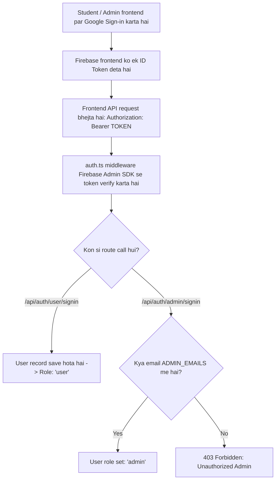
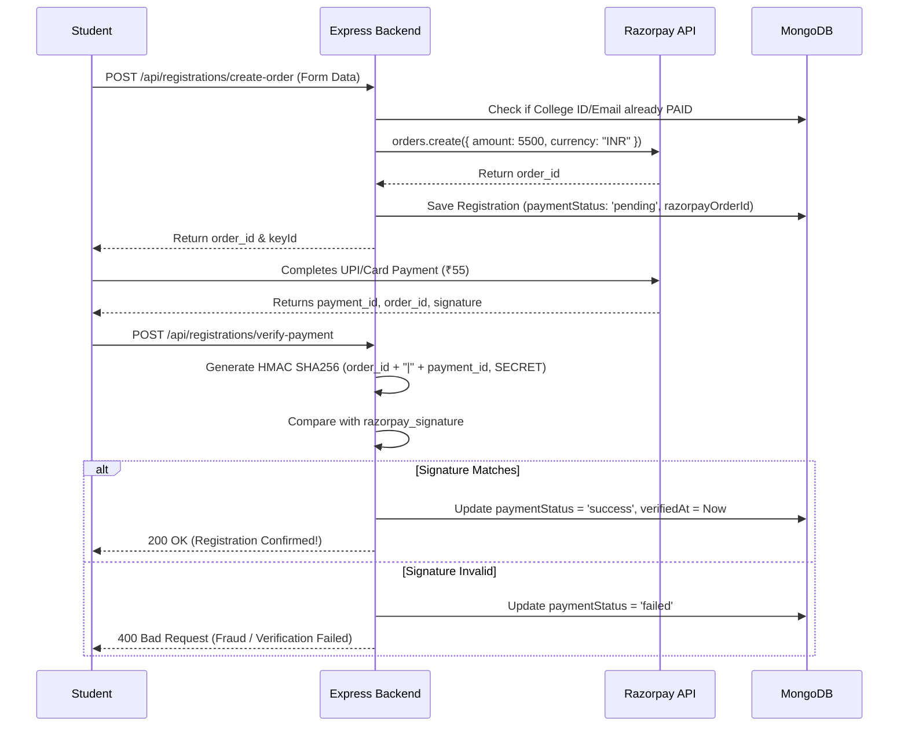

# 🚀 Part 1 — Backend Architecture & Core Concepts (`AmongU`)

Yeh document summarize karta hai ki **Part 1 (Backend)** mein humne kya kya banaya hai, kaunsi technologies use ki hain, aur har component background mein kaise kaam kar raha hai — taaki aap pura flow aur logic easily samajh sakein aur kisi ko bhi explain kar sakein.

---

## 1. 📌 Overview & Tech Stack

Aapka backend ek **REST API server** hai jo **AmongU** college event ke liye banaya gaya hai.

| Component | Technology | Role |
| :--- | :--- | :--- |
| **Runtime** | Node.js (v24+) | Server execution environment |
| **Framework** | Express.js | API routing, middlewares, request handling |
| **Language** | TypeScript | Strong typing, autocompletion, compile-time error checks |
| **Database** | MongoDB + Mongoose | Data modeling, indexing, queries |
| **Auth** | Firebase Admin SDK | Google Sign-In ke ID Tokens ko server-side verify karna |
| **Payments** | Razorpay SDK + Crypto | ₹55 order creation aur HMAC SHA256 signature verification |
| **Validation** | Zod | Form data aur `.env` variables ka strict validation |
| **Security** | Helmet + CORS | HTTP headers protection aur frontend domain control |

---

## 2. 🛡️ Core Rule: "Zero Fallbacks & Zero Defaults"

Aapki requirement ke mutabiq pure codebase mein **kahi par bhi `||` (default value)** nahi hai (jaise `PORT || 5000` ya `URI || localhost`).

### Yeh kaise kaam karta hai? (`src/config/env.ts`)
* Jab bhi server start hota hai, sabse pehle **Zod** aapki `.env` file ko scan karta hai.
* Agar ek bhi zaroori key (jaise `PORT`, `MONGO_URI`, `RAZORPAY_KEY_ID`, `FIREBASE_*`, `ADMIN_EMAILS`) missing hai ya invalid hai, toh server **turant halt (exit code 1)** ho jata hai aur terminal mein bata deta hai ki kaunsi key missing hai.
* Iska fayda: **No hidden bugs in production.** Server tabhi chalega jab environment 100% sahi configured ho.

---

## 3. 🔐 Authentication & Roles System

Aapke system mein 2 roles hain: **Student (`user`)** aur **Admin (`admin`)**.



### Files Involved:
* [`src/middlewares/auth.ts`](file:///c:/Users/Ankit%20Singh%20Tomar/AmongU/backend/src/middlewares/auth.ts): Header se Bearer token nikaalta hai, Firebase se verify karta hai, aur MongoDB user document ko `req.user` mein attach karta hai.
* [`src/middlewares/admin.ts`](file:///c:/Users/Ankit%20Singh%20Tomar/AmongU/backend/src/middlewares/admin.ts): Check karta hai ki `req.user.role === 'admin'`. Agar nahi hai toh 403 Forbidden return karta hai.
* [`src/controllers/auth.controller.ts`](file:///c:/Users/Ankit%20Singh%20Tomar/AmongU/backend/src/controllers/auth.controller.ts): Login sync logic aur `/api/auth/me` profile route.

---

## 4. 📝 Registration & Form Validation

Jab koi student register karta hai, toh **Zod** server-side par rules enforce karta hai taaki koi galat data DB mein na jaye:

### Validations Enforced:
1. **Name:** First name aur Last name dono hone chahiye ($\ge 2$ words).
2. **College ID:** Strictly **15 digits** hone chahiye (`^\d{15}$`).
3. **Year:** Sirf `1` ya `2` allowed hai (1st aur 2nd year students).
4. **Branch:** Allowed branch list se match hona zaroori hai:
   `CSE ai`, `cse aiml`, `cse`, `cs`, `csit`, `it`, `CYber security`, `Data science`, `EEE`, `ECE`, `AMIA`, `OTHER` *(case-insensitive handled)*.
5. **Section:** `A`, `B`, `C`, `D`, ya `E`.
6. **Phone:** 10-digit Indian WhatsApp number (`^[6-9]\d{9}$`).
7. **Email:** Strictly official KIET domain hona chahiye: `@kiet.edu`.

---

## 5. 💳 Razorpay Payment Flow (2-Step Verification)

Paisa handling sabse critical part hai. Humne **2-Step Verification with Cryptographic HMAC** implement kiya hai taaki koi fake payment confirm na kar sake:



### Backup Safety: Webhook
* Agar user payment karne ke baad browser galti se band kar deta hai, toh Razorpay background mein hamare `/api/registrations/webhook` ko hit karta hai, jisse status automatically `success` mark ho jata hai.

---

## 6. 📊 MongoDB Database Structure

Humne 2 Mongoose models banaye hain:

### 1. `User` Model ([`src/models/User.ts`](file:///c:/Users/Ankit%20Singh%20Tomar/AmongU/backend/src/models/User.ts))
* `firebaseUid`: Unique ID given by Google Auth.
* `email`: Student/Admin email.
* `name`: Student display name.
* `role`: `'user'` ya `'admin'`.

### 2. `Registration` Model ([`src/models/Registration.ts`](file:///c:/Users/Ankit%20Singh%20Tomar/AmongU/backend/src/models/Registration.ts))
* `userId`: Linked User reference.
* `name`, `collegeId`, `year`, `branch`, `section`, `phone`, `email`.
* `amount`: 55 (INR).
* `paymentStatus`: `'pending'` | `'success'` | `'failed'`.
* `paymentMethod`: `'razorpay'` | `'manual_cash'`.
* `razorpayOrderId`, `razorpayPaymentId`, `razorpaySignature`.
* `verifiedAt`: Payment confirm hone ka exact timestamp.
* `notes`: Admin notes ya manual entry remarks.

---

## 7. 👑 Admin Dashboard Capabilities

Admin ke paas full control ke liye APIs bani hain:

1. **Analytics (`GET /api/admin/stats`):**
   - Total registrations count.
   - Successful paid registrations & Total Revenue Collected (₹).
   - Pending & Failed counts.
   - Department-wise breakdown (kaunsi branch se kitne log aaye).
   - Year-wise breakdown (1st year vs 2nd year).
2. **Search, Filter & Pagination (`GET /api/admin/registrations`):**
   - Search by: Student Name, College ID, Email, Phone number, ya Payment ID.
   - Filter by: `branch`, `year`, `paymentStatus`.
3. **Manual Status Override (`PATCH /api/admin/registrations/:id/status`):**
   - Kisi student ka status manually change karna (e.g. UPI issue resolve hone par).
4. **On-Spot / Desk Registration (`POST /api/admin/registrations/manual`):**
   - Event day par desk par cash lene par admin direct student ko `manual_cash` ke saath register kar sakta hai.
5. **CSV Download (`GET /api/admin/export/csv`):**
   - Single click mein Excel/Sheets mein open karne ke liye CSV export stream.

---

## 8. 🗺️ Complete API Endpoints List

| Method | Endpoint | Protection | Description |
| :--- | :--- | :--- | :--- |
| **GET** | `/api/health` | Public | Server health & registration fee check |
| **POST** | `/api/auth/user/signin` | Bearer Token | User login & sync |
| **POST** | `/api/auth/admin/signin` | Bearer Token | Admin login (checks whitelist in `.env`) |
| **GET** | `/api/auth/me` | Bearer Token | Current logged-in user profile |
| **GET** | `/api/registrations/my-status` | Bearer Token | Logged-in student ka registration status |
| **POST** | `/api/registrations/create-order` | Bearer Token | ₹55 Razorpay order create karta hai |
| **POST** | `/api/registrations/verify-payment` | Bearer Token | Razorpay HMAC signature verify karke ticket confirm karta hai |
| **POST** | `/api/registrations/webhook` | Webhook Signature | Razorpay async payment capture event |
| **GET** | `/api/admin/stats` | Admin Only | Dashboard stats & total revenue |
| **GET** | `/api/admin/registrations` | Admin Only | Participant list with search & filter |
| **GET** | `/api/admin/registrations/:id` | Admin Only | Single registration details |
| **PATCH** | `/api/admin/registrations/:id/status` | Admin Only | Status override |
| **POST** | `/api/admin/registrations/manual` | Admin Only | Offline desk cash registration |
| **GET** | `/api/admin/export/csv` | Admin Only | CSV file download |

---

## 9. 📁 Folder Structure

```
backend/
├── src/
│   ├── config/
│   │   ├── env.ts          # Strict Zod env validation (0 fallbacks)
│   │   ├── db.ts           # MongoDB connection via Mongoose
│   │   ├── firebase.ts     # Firebase Admin SDK init
│   │   └── razorpay.ts     # Razorpay SDK init
│   ├── constants/
│   │   └── branches.ts     # Allowed branches, years, sections, KIET domain
│   ├── middlewares/
│   │   ├── auth.ts         # Firebase ID token verifier
│   │   ├── admin.ts        # Admin role guard (403 check)
│   │   ├── validate.ts     # Zod request body schemas
│   │   └── errorHandler.ts # Global error handler
│   ├── models/
│   │   ├── User.ts         # User schema (uid, email, name, role)
│   │   └── Registration.ts # Registration schema (details, paymentStatus, razorpay IDs)
│   ├── controllers/
│   │   ├── auth.controller.ts
│   │   ├── registration.controller.ts
│   │   └── admin.controller.ts
│   ├── routes/
│   │   ├── auth.routes.ts
│   │   ├── registration.routes.ts
│   │   └── admin.routes.ts
│   ├── utils/
│   │   └── csvExporter.ts  # Formats MongoDB records into downloadable CSV
│   ├── app.ts              # Express configuration & security
│   └── server.ts           # Entry point (DB connect & port listener)
├── .env.example            # Environment template
├── .gitignore
├── README.md               # Quick API docs
├── tsconfig.json           # TypeScript configuration
└── package.json            # Dependencies & scripts
```

---

## 10. 🎯 Next Steps (Jab aap ready hon)
1. `.env` file mein apni actual MongoDB URI, Firebase Service Account keys, aur Razorpay Test Keys fill karna.
2. Server ko `npm run dev` se start karna.
3. Next part (Part 2): **Frontend (Next.js with Among Us theme, user screens & admin dashboard)** start karna!
